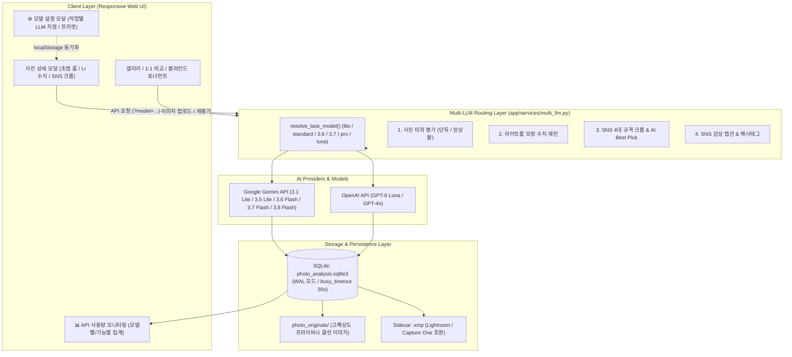

# Figure Photo Grader - 워크플로우 & 개발 가이드 (Workflow & Development Guide)

본 문서는 **Figure Photo Grader**의 최신 시스템 아키텍처, 다중 LLM(Multi-LLM) 처리 워크플로우, 프롬프트 엔지니어링 원칙, 그리고 무결성 검증 기반의 개발 방법론을 상세히 설명합니다.

---

## 1. 전체 시스템 아키텍처 (System Architecture)



---

## 2. 핵심 워크플로우 (Core Workflows)

### 2.1 사진 분석 & 앙상블 크로스체크 워크플로우
1. **개인정보 제거 및 인메모리 이미지 준비 (`app/services/image_processor.py`)**
   - GPS, 기기 일련번호, 개인정보 EXIF를 철저히 제거하고 안전한 광학 촬영 메타데이터(조리개, 셔터, ISO, 렌즈 등)만 보존.
   - **인메모리 바이트 파이프라인 (`prepare_photo_from_bytes`)**: 디스크에 불필요한 임시 파일을 쓰지 않고 메모리 상에서 이미지를 안전하게 정제/인코딩하여, 윈도우 환경 파일 핸들 잠금(`PermissionError [WinError 32]`)을 원천 차단.
   - 고해상도 이미지는 `data/photo_originals/`에 보관하고, 갤러리용 초경량 WebP 썸네일 동시 생성.
   - dHash(지각적 해시 64비트)를 계산하여 연사(Burst) 그룹 자동 감지 준비.
2. **모델 라우팅 및 평가 실행 (`app/services/multi_llm.py`)**
   - **단독 Gemini 평가**: `Flash-Lite 3.1`(초고속), `Flash-Lite 3.5`(표준 권장), `Flash 3.6`, `Flash 3.7`, `Flash 3.8`(심층) 중 선택된 모델로 1회 호출.
   - **Gemini + Luna 크로스체크 앙상블**: Gemini(Flash-Lite 3.5)의 광학적 본평가와 OpenAI(GPT-6 Luna)의 독립적 보조 비평을 병렬(`ThreadPoolExecutor`)로 수행.
   - **점수 왜곡 방지 원칙**: Gemini의 종합 점수를 인위적으로 평균내지 않고 보존하며, Luna의 비평을 독립된 `CrossCheckOpinion` 카드로 카드/모달에 병렬 표시.
3. **Pydantic 구조화 출력 & 자가치유 파서 (`app/models/analysis.py`)**
   - `model_json_schema()`에 `focus_status`(`'완벽 칼초점'`, `'미세 앞핀'` 등)와 `figure_category`의 `enum` 제약을 강제.
   - **방어적 자가치유 파서 (`_heal_choice`, `from_llm_json`)**: 다국어 토큰 분할 오탈자(예: `'완벽 칼초plet'` -> `'완벽 칼초점'`)나 비정형 응답 발생 시 표준 상수로 자동 정규화하고 점수 범위를 클램핑(0~10)하여 파싱 에러(500) 원천 방어.
4. **SQLite WAL 모드 & 쿼리 I/O 최적화 (`app/db/`)**
   - `PRAGMA journal_mode = WAL;` 및 `busy_timeout = 30000`으로 멀티스레드 동시 읽기/쓰기 락을 완전 해소.
   - 갤러리 대량 조회 시 거대한 `thumbnail` BLOB을 쿼리에서 분리 제외하여 대시보드 로딩 I/O를 90% 이상 절감.

### 2.2 온디맨드 라이트룸 보정 수치 제안 워크플로우
1. 상세 모달 내 **라이트룸 보정 수치** 영역에서 원하는 모델(`Luna 6`, `Flash 3.8`, `Flash 3.5` 등)을 선택하고 요청.
2. `POST /api/post-process-advice/<id>?model=<model>` 호출.
3. 모델이 피규어 사진의 노출(EV), 대비, 하이라이트(번들거림 제어), 섀도우(암부 복원), 텍스처, 화이트밸런스, 마스킹 가이드를 JSON으로 생성.
4. SQLite `lr_advice_json`에 영구 캐싱되며, 어떤 모델이 제안했는지 배지(`used_model`)가 함께 보존.

### 2.3 SNS 4대 규격 크롭 & AI Best Pick 워크플로우
1. **단 1회 API 호출**로 4대 규격(인스타 `4:5`, `1:1`, X `16:9`, `3:4`)과 AI 최적 구도 추천(`best_ratio_key`, `original_tip`)을 일괄 생성.
2. 원본 구도가 가장 뛰어난 경우 무리한 자르기 대신 `📷 원본 유지 (No Crop)`를 1순위로 추천.
3. 브라우저에서 버튼 클릭 시 원본 이미지 위에 반응형 크롭 박스(3분할 가이드)를 즉시 오버레이.
4. HTML5 Canvas를 이용해 원본 해상도에서 무손실 크롭 다운로드 수행 (서버 부하 0%).

---

## 3. 프롬프트 엔지니어링 설계 원칙

### 3.1 Gemini 주 심사자 프롬프트 (`app/prompts/grader_prompts.py`)
- **피규어 4대 촬영 유형 분기**: 접사/디테일(`macro`), 일상/야외 스냅(`snap`), 스튜디오 연출(`staging`), 일반 전시(`general`)별 특화 채점 기준 적용.
- **초점 핀 정밀 심사 (`focus_status`)**: 아이 데칼(눈동자) 경계면과 반사광을 기준으로 앞핀/뒤핀/칼초점을 냉정하게 판정.
- **워터마크/하단 프레임 촬영 설정 감지**: 라이카 프레임 등 시각적 인쇄 메타데이터를 인식해 광학 기술 평가에 자동 반영.

### 3.2 Luna(GPT-6) 크로스체크 프롬프트 (Option B: 객관적 공정 진단형)
- **4단계 사고흐름 미러링**: Gemini의 체계적인 시각 진단 프로세스(형태·포즈 → 빛·색조 → 광학·초점 → 총평 및 개선점)를 미러링.
- **비평가 페르소나 정렬**: 과도한 감점 집착이나 비아냥거림을 배제하고, 사진의 강점을 정당하게 칭찬하면서도 다음 촬영을 위한 실질적 조언을 제시하는 공정한 진단자 톤 유지.

---

## 4. 개발 방법론 & 코드 무결성 검증 체계

### 4.1 모듈형 아키텍처 원칙
- **UI 서브시스템 분리**:
  - `static/js/api.js`: REST API 통신 및 모델 전역 설정 관리 (`ModelSettings`)
  - `static/js/crop_viewer.js`: SNS 크롭 연산, 캔버스 다운로드, 캡션 클립보드 복사
  - `static/js/tag_filter.js`: 미학 태그 필터링 및 8대 어휘 카탈로그
  - `static/js/tournament.js`: 블라인드 1:1 토너먼트 매치, 브래킷 관리, 우승작 선정
  - `static/js/tag_insights.js`: 미학 태그 통계 차트 및 1:1 사진 비교 뷰
  - `static/js/modals.js`: 일괄 사진 업로드(드롭존), API 사용량 통계 모달, 모델 설정 모달
  - `static/dashboard.js`: 갤러리 40장 단위 프로그레시브 청크 렌더러(`IntersectionObserver`), 테마 토글, 사진 상세 검사기(EXIF, 줌, 재평가)
- **백엔드 서비스 분리**:
  - `app/services/image_processor.py`: 무손실 리사이즈, EXIF 정제, dHash 연산
  - `app/services/multi_llm.py`: 다중 공급자(Gemini, OpenAI) 모델 라우팅
  - `app/services/gemini_client.py`: Gemini 클라이언트, 세마포어(동시성 제어), 지수 백오프
  - `app/services/openai_client.py`: OpenAI 구조화 출력(Structured Outputs), JSON 폴백
  - `app/db/connection.py` & `repository.py`: WAL 모드 SQLite 영속성 레이어

### 4.2 테스트 주도 무결성 검증 (Test-Driven Integrity)
- **프론트엔드 정적 무결성 검증 (`tests/test_frontend_integrity.py`)**:
  - 전체 분리된 JS 모듈 내 `document.getElementById('...')` 호출 대상이 `templates/index.html`에 실제로 존재하는지 자동 검사.
  - HTML 태그의 모든 `onclick="fn(...)"` 핸들러가 JS 파일에 정의되어 있는지 문법 파싱 검증.
- **다중 LLM 라우터 및 모델 파싱 검증 (`tests/test_openai_client.py`)**:
  - `resolve_task_model`의 티어 및 모델 식별자 매핑 검증.
  - Gemini / OpenAI 분기 호출 및 구조화 출력 모델 호환성 모킹 테스트.
- **LLM 자가치유 파서 검증 (`tests/test_photo_analyzer.py`, `tests/test_openai_client.py`)**:
  - 불완전한 JSON 및 오탈자 Enum 입력 시 `from_llm_json`의 정상 복원 여부 검증.
- **재평가 및 크로스체크 엔드포인트 검증 (`tests/test_reanalyze.py`)**:
  - 웹 대시보드 내 전체 재평가 및 OpenAI 단독 크로스체크 API 통합 검증.
- **Node.js 헤드리스 렌더링 검증 (`tests/test_dashboard_modularization.py`)**:
  - Node.js 환경에서 크롭 좌표 연산(`calculateExactCrop`)과 HTML 이스케이프가 브라우저 없이도 오류 없이 실행되는지 자동 검증.

---

## 5. 실행 및 개발 명령어 치트시트

```powershell
# 가상환경 활성화
.\.work\venv\Scripts\Activate.ps1

# 전체 유닛 테스트 실행 (87개 전 항목 검증)
$env:PYTHONPATH="c:\Users\gkwjd\photo-recovery"
python -m unittest discover -s tests

# 특정 테스트 단독 실행
python -m unittest tests/test_frontend_integrity.py
python -m unittest tests/test_photo_analyzer.py
python -m unittest tests/test_openai_client.py
python -m unittest tests/test_reanalyze.py

# 웹 대시보드 개발 서버 실행
python photo_dashboard.py --port 8080 --host 127.0.0.1
```
