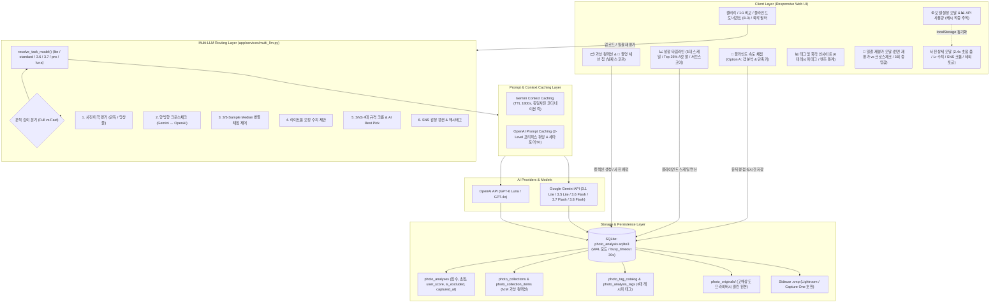

# Figure Photo Grader - 워크플로우 & 개발 가이드 (Workflow & Development Guide)

본 문서는 **Figure Photo Grader**의 최신 시스템 아키텍처, 다중 LLM(Multi-LLM) 처리 워크플로우, 프롬프트 엔지니어링 원칙, 그리고 무결성 검증 기반의 개발 방법론을 상세히 설명합니다.

---

## 1. 전체 시스템 아키텍처 (System Architecture)



---

## 2. 핵심 워크플로우 (Core Workflows)

### 2.1 사진 분석 & 양방향 크로스체크 워크플로우
1. **개인정보 제거 및 인메모리 이미지 파이프라인 (`app/services/image_processor.py`)**
   - GPS, 기기 일련번호, 개인정보 EXIF를 철저히 소거하고 조리개, 셔터스피드, ISO, 초점거리, 렌즈 모델만 안전 보존.
   - **인메모리 바이트 파이프라인 (`prepare_photo_from_bytes`)**: 디스크 임시 파일 없이 메모리 상에서 이미지를 안전하게 정제/인코딩하여, Windows 환경 파일 핸들 잠금(`PermissionError [WinError 32]`)을 원천 차단.
   - 고해상도 이미지는 `data/photo_originals/`에 보관하고, 갤러리용 초경량 WebP 썸네일 동시 생성.
   - 지각적 해시(dHash 64비트)를 계산하여 연사(Burst) 그룹 자동 감지 준비.
2. **분석 깊이 모드 분기 (Full vs Fast)**
   - **정밀 모드 (`PhotoAnalysis`)**: 4대 영역별 장단점 분리 노트, 6대 물리 레시피 태그, 종합 점수 근거, 강점/개선점 목록을 완비하여 심층 비평.
   - **경량 모드 (`FastPhotoAnalysis`, `--fast`)**: 대량 사진 Culling을 위해 태그 생성을 생략하고 5대 점수 + 초점 핀 + 1줄 핵심 사유만 1~2초 내에 추출.
3. **양방향 크로스체크 라우터 (`cross_check_photo`)**
   - **Gemini 주평가 시**: OpenAI GPT-6 Luna가 독립된 보조 진단을 신속히 수행.
   - **OpenAI 주평가 시**: Gemini(Flash-Lite 3.5 등)가 상대적 관점에서 보조 비평을 수행.
   - **점수 보존 원칙**: 주 모델의 종합 점수를 인위적으로 평균내지 않고 보존하며, 상대 모델의 의견은 4대 서브점수(`composition_score`, `lighting_score` 등)와 함께 `CrossCheckOpinion` 카드로 카드/모달에 병렬 표시.
4. **Pydantic 구조화 출력 & 방어적 자가치유 파서 (`app/models/analysis.py`)**
   - `model_json_schema()`에 `focus_status`(`'완벽 칼초점'`, `'미세 앞핀'` 등)와 `figure_category`의 `enum` 제약을 강제.
   - **자가치유 파서 (`_heal_choice`, `_fuzzy_match_choice`, `from_llm_json`)**: 토큰 분할 오탈자(예: `'완벽 칼초plet'` -> `'완벽 칼초점'`)나 비정형 응답 발생 시 표준 상수로 자동 정규화하고 점수 범위를 클램핑(0~10)하여 500 파싱 에러를 원천 방어.
5. **SQLite WAL 모드 & 쿼리 I/O 최적화 (`app/db/`)**
   - `PRAGMA journal_mode = WAL;` 및 `busy_timeout = 30000`으로 멀티스레드 동시 읽기/쓰기 락을 완전 해소.
   - 갤러리 대량 조회 시 거대한 `thumbnail` BLOB을 쿼리에서 분리 제외하여 대시보드 로딩 I/O를 90% 이상 절감.

### 2.2 온디맨드 라이트룸 보정 수치 제안 워크플로우
1. 상세 모달 내 **라이트룸 보정 수치** 영역에서 원하는 모델(`Luna`, `Flash 3.8`, `Flash 3.5` 등)을 선택하고 요청.
2. `POST /api/post-process-advice/<id>?model=<model>` 호출.
3. 모델이 피규어 사진의 노출(EV), 대비, 하이라이트(번들거림 제어), 섀도우(암부 복원), 텍스처, 화이트밸런스, 마스킹 가이드를 JSON으로 생성.
4. SQLite `lr_advice_json`에 영구 캐싱되며, 어떤 모델이 제안했는지 배지(`used_model`)가 함께 보존.

### 2.3 SNS 4대 규격 크롭 & AI Best Pick 워크플로우
1. **단 1회 API 호출**로 4대 규격(인스타 `4:5`, `1:1`, X `16:9`, `3:4`)과 AI 최적 구도 추천(`best_ratio_key`, `original_tip`)을 일괄 생성.
2. 원본 구도가 가장 뛰어난 경우 무리한 자르기 대신 `📷 원본 유지 (No Crop)`를 1순위로 추천.
3. 브라우저에서 버튼 클릭 시 원본 이미지 위에 반응형 크롭 박스(3분할 가이드)를 즉시 오버레이.
4. HTML5 Canvas를 이용해 원본 해상도에서 무손실 크롭 다운로드 수행 (서버 부하 0%).

### 2.4 화각(초점거리) 추출 및 렌즈 성능 분석 파이프라인
1. **광학 메타데이터 우선순위 추출 (`extract_focal_length_mm`, `extract_lens_model`)**:
   - 1순위: EXIF `FocalLengthIn35mmFilm` (풀프레임 환산 화각)
   - 2순위: EXIF `FocalLength` (단일 초점거리)
   - 3순위: AI 감지 설정(`detected_camera_settings.focal_length` 또는 단렌즈 `lens` OCR 텍스트)
   - 4순위: 메타데이터가 없는 웹/스크린샷 사진은 `unknown (화각 미식별)`으로 안전 분류
2. **사진학적 5대 표준 화각대 버킷팅 (`classify_focal_band`)**:
   - `wide_24` (24mm 이하 광각), `semi_wide_35` (35mm 부근 준광각), `standard_50` (50mm 부근 표준), `portrait_85` (70~85mm 준망원), `tele_100` (100mm+ 망원/매크로).
3. **핵심 강점/약점 피드백 클러스터링 (`summarizeFeedbackThemes`)**:
   - 화각대별 AI 심사평에서 칼초점, 배경 분리(보케), 색감 대비, 공간감 연출, 림라이트 부족, 가장자리 잘림 등 주요 사진학적 테마를 빈도순으로 자동 그룹핑하고 실제 심사평 인용문을 매핑.

### 2.5 가상 컬렉션(Virtual Collections) & 촬영 세션 클러스터링 워크플로우
1. **Lightroom 스타일 가상 컬렉션**:
   - `photo_collections` 및 `photo_collection_items` N:M 테이블 설계로 하나의 사진이 여러 컬렉션(예: "2026 베스트", "아키하바라 출사")에 동시에 속할 수 있도록 지원.
   - 사진 다중 선택 모드(`toggleBatchSelectMode`)에서 원클릭 일괄 담기 및 제외 처리.
   - 폴더 업로드 시 최상위 폴더명을 파싱하여 가상 컬렉션을 자동 생성·배정.
2. **EXIF 촬영 일시 기반 출사 세션 자동 분할**:
   - `captured_at` 타임스탬프를 정렬하여 인접 사진 간 촬영 간격이 2시간을 초과하면 새로운 출사 세션으로 자동 분리.
   - 세션 칩 클릭 시 해당 세션 사진만 갤러리/통계/타임라인에 즉각 스코프 적용.

### 2.6 성장 타임라인(Score Growth Timeline) & 블라인드 채점 워크플로우
1. **성장 타임라인 알고리즘 (`static/js/growth_timeline.js`)**:
   - 브라우저 클라이언트 메모리에서 전체 분석 기록을 5대 다중 스케일(`session`, `weekly`, `monthly`, `quarterly`, `mileage`)로 집계.
   - 각 버킷별로 전체 평균(`avg`), 상위 25% A컷 풀(`top25`), 피크 점수(`best`), 사용자 직접 평점(`userAvg`), 4대 세부영역 점수를 동시 산출.
   - 반응형 SVG 선 그래프로 렌더링하며 마우스 호버 시 썸네일과 점수 정보를 포함한 툴팁 표시.
2. **블라인드 채점 서브시스템 (`static/js/blind_rating.js`, Option A)**:
   - AI 점수를 마스킹한 상태에서 무작위 또는 미평가 사진을 제시.
   - 키보드 숫자 단축키로 사용자 평점을 즉시 입력받아 `user_score` 컬럼에 실시간 반영.
   - 입력 즉시 AI 점수와 오버레이하여 차이 갭(일치/호평/엄격)을 피드백하고, 세션 통계(평균 점수, 최대 의견 일치/불일치 컷) 리포트 렌더링.

### 2.7 프롬프트/컨텍스트 캐싱 및 동시성 코디네이션 아키텍처
1. **Gemini Context Caching**:
   - 방대한 정적 시스템 비평 지침에 대해 `types.CreateCachedContentConfig`를 적용 (TTL 1800초 유지).
   - 동일 사진 병렬 샘플링(3회/5회 중앙값 채점) 시 콜드 캐시 스탬피드를 차단하기 위해 `_GEMINI_COORD_LOCK`과 사진별 코디네이션 락을 적용하여 첫 번째 호출이 캐시를 생성한 뒤 후속 호출이 안전하게 캐시를 히트하도록 조정.
2. **OpenAI Prompt Caching (2-Level Coordination)**:
   - Level 1: 정적 시스템 프롬프트 프리픽스 체크포인트를 사전 워밍하여 크로스 사진 간 KV 캐시 적중률 극대화.
   - Level 2: 동일 사진 SHA-256 코디네이션 락으로 동시 호출 시 캐시 축출(Eviction) 방지.
   - 세마포어 상한을 50(`MAX_CONCURRENT_OPENAI_CALLS = 50`)으로 확장하여 대량 재평가 시 처리량 극대화.

### 2.8 신규 사진 분석 및 CLI의 병렬 중앙값(Median) 채점 파이프라인
1. **웹 대시보드 업로드 모달 (`static/js/modals.js` & `templates/index.html`)**:
   - 신규 사진 업로드 모달(`openUploadModal`)에 `🎯 병렬 채점 후 중앙값(Median) 채택` 체크박스(`upload-median`) 및 표본 수(`upload-sample-count`: 3회/5회) 설정 UI 탑재.
   - `onUploadMedianChange` 이벤트 핸들러를 통해 체크 해제 시 드롭다운 비활성화 및 스타일 조절, `window.ModelSettings`와의 양방향 동기화 지원.
   - 단일/일괄 사진 업로드 시 `FormData`에 `sample_count`를 추가 전달하여 백엔드 `/api/analyze`로 전송.
   - 업로드 및 일괄 분석 진행 중 프로그레스 바에 `(🎯 3회 병렬)` 형태로 실시간 진행 상태 노출.
2. **CLI & 일괄 분석 파이프라인 (`app/cli.py` & `app/services/batch_service.py`)**:
   - CLI 파서에 `--samples`, `--sample-count` (1, 3, 5) 옵션 추가.
   - 단일 파일 분석 및 폴더 일괄 분석 파이프라인(`run_batch_pipeline`) 모두 `sample_count` 인자를 받아 `multi_llm.analyze_photo`로 안전하게 위임.

---

## 3. 프롬프트 엔지니어링 설계 원칙

### 3.1 Gemini 주 심사자 프롬프트 (`app/prompts/grader_prompts.py`)
- **피규어 4대 촬영 유형 및 2대 심사 트랙**:
  - `Track A (비통제 일상·야외 스냅)`: 자연광 활용, 실제 환경과 피규어의 스케일 조화, 계절감 및 서사성.
  - `Track B (통제된 전용 세팅)`: 스튜디오 조명(키/필/림라이트), 3D 공간 레이어링, 매크로 초정밀 핀 및 번들거림 억제.
- **Method A 스케일 스트레칭 (Scale Stretching)**:
  - **스탠다드 샷 기준점(Anchor) 재설정**: 결함 없는 평범한 스탠다드 기록 샷의 앵커는 7.8점이 아니라 **6.8 ~ 7.2점**.
  - **8.3 ~ 8.9점 화보 버퍼존**: 상급 화보 구간으로 적극 활용하여 8점대 중후반 점수를 주저 없이 부여.
  - **9.0 ~ 9.4점 마스터피스**: 5대 체크리스트 무결점 + 프로급 완성도와 시너지(+0.1~+0.2).
  - **9.5 ~ 10.0점 더 레전드**: 세부점수 9.3+ 이상 및 완결된 장면 의도(Scene Intent).
- **5대 광학·구도 체크리스트 선행 검증**:
  - 점수 책정 전 ①안면 칼초점 ②노출 계조 ③플라스틱 핫스팟 억제 ④배경 분리 ⑤색온도 밸런스를 검증하여 `quick_summary`에 선행 출력.
- **세트장 경미 노출 판정 가이드**:
  - 모니터 베젤 등 경미한 가장자리 노출은 4점대로 폭락시키지 않고 구도 점수 -1.0~-1.5점 감점으로 6.0~7.4점대에 유연하게 안착.
  - 투명 베이스/지지대 노출은 정상 전시 요소이므로 감점 사유에서 제외 (스타일의 선택).
- **6대 물리 촬영 레시피 태그 단일 선택**:
  - `shot_scale`, `camera_angle`, `light_direction`, `light_quality`, `depth_of_field`, `color_tone` 각 1개 단일 매핑.

### 3.2 OpenAI(GPT-6 Luna) 크로스체크 프롬프트
- **양방향 크로스체크 미러링**: Gemini의 체계적인 시각 진단 프로세스를 미러링하되, 구도/조명 2대 서브점수를 함께 생성하여 직관적인 비교를 가능케 함.
- **비평가 페르소나 정렬**: 과도한 감점 집착을 배제하고, 사진의 강점을 정당하게 칭찬하면서 다음 촬영을 위한 실질적 조언을 제시하는 공정한 진단자 톤 유지.

---

## 4. 개발 방법론 & 코드 무결성 검증 체계

### 4.1 모듈형 아키텍처 원칙

#### 프론트엔드 모듈 분리 (`static/js/` 및 `static/`)
- `static/js/api.js`: REST API 통신 및 전역 모델 설정 관리 (`ModelSettings`).
- `static/js/tag_filter.js`: 6대 물리 레시피 태그 필터링 및 카탈로그 관리.
- `static/js/crop_viewer.js`: SNS 4대 규격 크롭 연산, HTML5 캔버스 무손실 다운로드, 캡션 클립보드 복사.
- `static/js/tournament.js`: 블라인드 1:1 토너먼트 매치 및 브래킷 관리 (B-3).
- `static/js/blind_rating.js`: 블라인드 랜덤 속도 채점 및 즉각 AI 갭 분석 서브시스템 (Option A).
- `static/js/tag_insights.js`: 6대 레시피 태그 및 5대 화각대별 렌즈 성능/강점·약점 심층 분석 대시보드 및 1:1 비교 뷰.
- `static/js/modals.js`: 사진 업로드(드롭존), API 사용량 통계(날짜 범위 동기화), 모델 설정 모달.
- `static/js/rating_advice.js`: 인라인 점수 가이드 툴팁 및 평가 가이드 렌더러.
- `static/js/reanalyze.js`: 웹 대시보드 선택 사진 일괄 재평가(전면 재평가 vs 크로스체크 채워넣기, 3/5회 중앙값, 최대 50 병렬) 및 단일 재평가 패널.
- `static/js/growth_timeline.js`: 5대 스케일 다중 그룹핑 사진 점수 성장 타임라인 차트 및 Top-25% A컷 풀 연산.
- `static/js/detail_modal.js`: 사진 상세 검사기 (2.4x 마우스 줌, EXIF, 라이트룸 슬라이더, 크로스체크 카드, 통계 제외 토글).
- `static/dashboard.js`: 2단 슬림 툴바, 가상 컬렉션, 날짜 세션 칩, 40장 단위 프로그레시브 청크 렌더러, 다크룸 테마 스위처.

#### 백엔드 서비스 분리 (`app/`)
- `app/services/image_processor.py`: 무손실 리사이즈, EXIF 정제, dHash 연산, 인메모리 파이프라인.
- `app/services/multi_llm.py`: 다중 공급자 모델 라우팅, 경량/정밀 분기, 양방향 크로스체크 및 3회 중앙값 앙상블.
- `app/services/gemini_client.py`: Gemini 클라이언트, `types.CreateCachedContentConfig` 컨텍스트 캐싱, 코디네이션 락, 지수 백오프.
- `app/services/openai_client.py`: OpenAI 구조화 출력(Structured Outputs), 2단계 프롬프트 캐시 코디네이션, 동시성 세마포어(50).
- `app/services/batch_service.py`: 폴더 일괄 분석 CLI 오케스트레이션.
- `app/db/connection.py` & `repository.py`: WAL 모드 SQLite 영속성 레이어, 가상 컬렉션 및 태그 정규화 테이블, 통계 제외 필터링.
- `app/web/handlers.py`: REST API 라우트 핸들러 및 정적 자원 서빙.

### 4.2 테스트 주도 무결성 검증 (Test-Driven Integrity)

현재 프로젝트는 **총 122개의 단위 테스트**를 통해 프론트엔드와 백엔드의 완전한 무결성을 보장합니다:

- **프론트엔드 정적 무결성 검증 (`tests/test_frontend_integrity.py`)**:
  - 12개 전체 JS 모듈 내의 `document.getElementById('...')` 대상이 `templates/index.html`에 실제로 존재하는지 자동 검사.
  - HTML 태그의 모든 `onclick="fn(...)"` 및 이벤트 핸들러가 JS 파일에 정의되어 있는지 문법 파싱 검증.
  - Node.js 환경에서 스크립트들이 문법 오류(식별자 중복 선언 등) 없이 순차 실행되는지 런타임 검증.
- **사진 통계 제외 격리 검증 (`tests/test_exclusion_feature.py`)**:
  - `is_excluded = 1` 플래그 지정 시 태그 인사이트 및 화각 통계 집계에서 완벽히 격리되는지 검증.
- **성정 타임라인 및 클러스터링 검증 (`tests/test_growth_timeline.py`)**:
  - Node.js VM 환경에서 5대 스케일 그룹핑, Top-25% A컷 풀 산출, 결측치 보정 알고리즘 검증.
- **다중 LLM 라우터 및 모델 파싱 검증 (`tests/test_openai_client.py`)**:
  - `resolve_task_model`의 티어 및 모델 매핑, 양방향 크로스체크 및 구조화 출력 모델 호환성 모킹 검증.
- **LLM 자가치유 파서 검증 (`tests/test_photo_analyzer.py`)**:
  - 불완전한 JSON 및 오탈자 Enum 입력 시 `from_llm_json`의 정상 복원 및 점수 클램핑 검증.
- **재평가 및 크로스체크 엔드포인트 검증 (`tests/test_reanalyze.py`)**:
  - 대시보드 내 일괄 재평가, 3회 중앙값 샘플링 및 크로스체크 엔드포인트 통합 검증.
- **태그 인사이트 및 화각 통계 검증 (`tests/test_tag_insights_and_rating.py`)**:
  - 사용자 직접 평가 저장/로드, 6대 레시피 태그 집계, 초점거리(mm) 추출 우선순위 및 5대 화각대 분류 검증.
- **Excel 매니저 & HTML 보고서 검증 (`tests/test_photo_excel_manager.py`, `tests/test_photo_html_report.py`)**:
  - 6대 레시피 태그 기반 엑셀 임포트/익스포트 및 오프라인 HTML 보고서 생성 검증.

---

## 5. 실행 및 개발 명령어 치트시트

```powershell
# 가상환경 활성화
.\.work\venv\Scripts\Activate.ps1

# 전체 유닛 테스트 실행 (122개 전 항목 검증)
$env:PYTHONPATH="c:\Users\gkwjd\photo-recovery"
python -m unittest discover -s tests

# 특정 테스트 단독 실행
python -m unittest tests/test_frontend_integrity.py
python -m unittest tests/test_exclusion_feature.py
python -m unittest tests/test_growth_timeline.py
python -m unittest tests/test_photo_analyzer.py
python -m unittest tests/test_reanalyze.py

# 웹 대시보드 개발 서버 실행
python photo_dashboard.py --port 8080 --host 127.0.0.1
```
